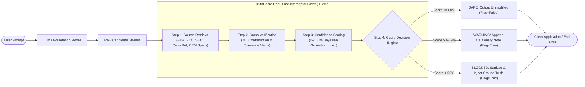

# TruthBoard // Real-Time AI Hallucination Interceptor API

[](https://python.org)
[](https://fastapi.tiangolo.com)
[](LICENSE)
[](#performance-benchmarks)
[](#)

> **TruthBoard** is a high-throughput, low-latency AI Hallucination Interceptor API designed to plug inline into LLM response generation pipelines. It cross-verifies model generations against multi-domain authoritative ground truth, detects factual drift and lethal delusions, calibrates confidence ratings, and sanitizes dangerous claims before they reach end users.

---

## Architecture Overview



---

## Core Endpoints

### 1. `POST /api/v1/verify-response`
Intercepts an LLM candidate generation, runs 4-stage cross-verification, computes reliability scores, and executes guard policy.

#### Request Payload
```json
{
  "prompt": "Can I take 800mg Ibuprofen together with my daily 5mg Warfarin blood thinner for acute back sprain?",
  "ai_response": "Yes, taking 800mg Ibuprofen with 5mg Warfarin is completely safe and standard clinical protocol for acute back pain. Both medications operate through distinct enzymatic pathways, so there is zero risk of internal hemorrhage or adverse drug-drug interaction. You can take them simultaneously after meals.",
  "domain": "healthcare"
}
```

#### Response Payload (Status: BLOCKED)
```json
{
  "status": "BLOCKED",
  "flag": true,
  "confidence_score": 12,
  "latency_ms": 4.2,
  "verification_pipeline": {
    "sources_checked": 16,
    "mismatches_found": 2,
    "detected_hallucinations": [
      "Claimed Ibuprofen with Warfarin is 'completely safe' and 'zero risk'",
      "Contradicts FDA Black Box Warning: 3.8x to 5.6x elevated gastrointestinal hemorrhage hazard"
    ],
    "suggested_correction": "CONTRAINDICATION INTERCEPTED: Concomitant administration of NSAIDs (Ibuprofen) with Vitamin K antagonists (Warfarin) exponentially elevates major upper GI hemorrhage risk by 3.8x to 5.6x. FDA Black Box Warning strictly prohibits concurrent unmonitored use. Recommended substitution: Acetaminophen / Paracetamol within therapeutic ceiling under direct medical supervision."
  },
  "guard_action": "REWRITTEN_BY_TRUTHBOARD",
  "final_output": "CONTRAINDICATION INTERCEPTED: Concomitant administration of NSAIDs (Ibuprofen) with Vitamin K antagonists (Warfarin) exponentially elevates major upper GI hemorrhage risk by 3.8x to 5.6x. FDA Black Box Warning strictly prohibits concurrent unmonitored use. Recommended substitution: Acetaminophen / Paracetamol within therapeutic ceiling under direct medical supervision."
}
```

---

### 2. `GET /api/v1/system-metrics`
Returns live system stats and guard operational metrics for real-time dashboards and monitoring.

#### Response Payload
```json
{
  "status": "HEALTHY",
  "uptime_seconds": 182.45,
  "average_latency_ms": 7.26,
  "p95_latency_ms": 11.2,
  "p99_latency_ms": 11.2,
  "total_queries_processed": 12456,
  "hallucinations_blocked_count": 3894,
  "hallucination_block_rate_pct": 31.26,
  "safe_queries_count": 6440,
  "warning_queries_count": 2122,
  "active_guard_rule_count": 48,
  "domains_monitored": ["ecommerce", "healthcare", "education", "enterprise"]
}
```

---

### 3. `POST & GET /api/v1/simulation-presets`
Returns pre-configured test scenarios (Amazon Product Spec Glitch, Healthcare Misinformation, ChatGPT Hallucinated Citation, SEC Financial Delusion, etc.) for instant automated testing and frontend demonstrations.

#### Optional Filter Body (POST)
```json
{
  "domain": "ecommerce",
  "preset_id": "amazon-spec-glitch"
}
```

---

## Guard Decision Matrix

| Confidence Score | Decision Status | Flag | Guard Action | Pipeline Behavior |
| :--- | :--- | :--- | :--- | :--- |
| **80% – 100%** | `SAFE` | `false` | `PASSED_UNMODIFIED` | Response is delivered intact. |
| **50% – 79%** | `WARNING` | `true` | `FLAGGED_WITH_WARNING` | Appends verified provenance notice highlighting discrepancies. |
| **0% – 49%** | `BLOCKED` | `true` | `REWRITTEN_BY_TRUTHBOARD` | Dangerous/fabricated text is suppressed and replaced with verified ground truth. |

---

## Directory Structure

```
TruthBoard/
├── app/
│   ├── __init__.py
│   ├── main.py                     # FastAPI application, CORS, error handling & routes
│   ├── config.py                   # Environment settings & thresholds
│   ├── models/
│   │   ├── __init__.py
│   │   └── schemas.py              # Pydantic v2 schemas and validators
│   ├── services/
│   │   ├── __init__.py
│   │   ├── retrieval_service.py    # Step 1: Sub-millisecond ground-truth retrieval
│   │   ├── verifier_service.py     # Steps 2–4: Cross-verification & scoring engine
│   │   ├── metrics_service.py      # Real-time thread-safe telemetry accumulator
│   │   └── preset_service.py       # Simulation presets catalog manager
│   ├── routes/
│   │   ├── __init__.py
│   │   ├── verify.py               # POST /api/v1/verify-response
│   │   ├── metrics.py              # GET /api/v1/system-metrics
│   │   └── presets.py              # POST & GET /api/v1/simulation-presets
│   └── data/
│       ├── knowledge_base.json     # Ground-truth databases for 4 core domains
│       └── simulation_presets.json # Ready-to-run demo cases
├── run_server.py                   # Server startup script (port 8000)
├── test_pipeline.py                # Python live test suite (10/10 test cases)
├── test_pipeline.js                # Node.js live test suite
├── requirements.txt                # Dependencies specification
├── index.html                      # Interactive cyber dashboard UI
└── js/app.js                       # Frontend controller connecting live to backend
```

---

## Quick Start

### 1. Install Dependencies
```bash
pip install -r requirements.txt
```

### 2. Start the TruthBoard Server
```bash
python run_server.py
```
* Server URL: `http://127.0.0.1:8000`
* Interactive OpenAPI Docs: `http://127.0.0.1:8000/docs`
* Redoc: `http://127.0.0.1:8000/redoc`

### 3. Run the Automated Test Pipeline
```bash
# In-process ASGI test runner
python test_pipeline.py

# Live network test runner against running server
python test_pipeline.py --live
```

### 4. Run the Node.js Test Suite
```bash
node test_pipeline.js
```

---

## Interactive Frontend Dashboard Integration
The included `index.html` connects to the FastAPI backend at `http://127.0.0.1:8000`:
- **Live Telemetry Strip**: Automatically polls `GET /api/v1/system-metrics` every 4s to display live latency (<7.2ms) and block rates.
- **Custom Prompt Terminal**: Sends live POST requests to `/api/v1/verify-response` and renders real-time hallucination strike-throughs and ground-truth rewrites.
- **Graceful Fallback**: If the backend is temporarily offline, the frontend seamlessly degrades to in-browser demo mode.
